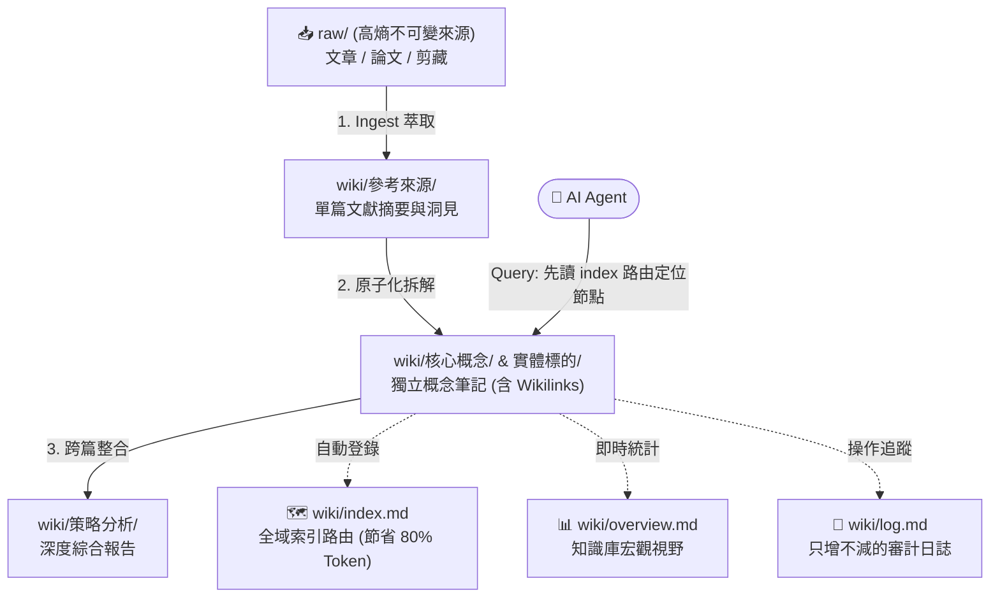

# 🧠 Obsidian Second Brain 通用空白模板與鷹架 (Scaffold)

[](https://github.com/ChaosConcerto/obsidian-second-brain-template/generate)
[](LICENSE)
[](https://obsidian.md/)

本專案為開箱即用的 **Obsidian 第二大腦 (Second Brain) 通用空白模板與自動化鷹架工具**。

依據 **Andrej Karpathy LLM Wiki** 理念設計，專為 **Google Antigravity、Claude Code、Cursor、Windsurf** 等現代 AI Coding Agent 打造高效、低 Token 消耗、具備自癒與審計能力的個人知識庫編譯架構。

---

## 🚀 快速開始（三種使用方式）

### 方式一：一鍵 Curl 遠端安裝（最推薦 ⚡）

無須 Clone 本儲存庫，在終端機執行下列指令即可秒建全新專案庫：

```bash
curl -fsSL https://raw.githubusercontent.com/ChaosConcerto/obsidian-second-brain-template/main/scaffold.sh | bash -s "你的專案名稱" "專案領域與主題描述"
```

> **範例**：
> ```bash
> curl -fsSL https://raw.githubusercontent.com/ChaosConcerto/obsidian-second-brain-template/main/scaffold.sh | bash -s "神經科學與AI研究" "大腦計算模型與神經迴路調研"
> ```

---

### 方式二：GitHub 「Use this template」（點擊即用 📦）

1. 點擊本頁右上角綠色的 [**Use this template**](https://github.com/ChaosConcerto/obsidian-second-brain-template/generate) 按鈕。
2. 建立屬於你的新知識庫儲存庫。
3. `git clone` 到本地並以 Obsidian 開啟即可直接使用！

---

### 方式三：本地 Clone 腳本執行 🛠️

```bash
git clone https://github.com/ChaosConcerto/obsidian-second-brain-template.git
cd obsidian-second-brain-template
./scaffold.sh "新專案名稱" "專案領域與主題描述"
```

---

## 📂 模板目錄架構與分工

```text
{{新專案名稱}}/
├── AGENTS.md                  # 專案憲法：AI Agent 行為準則、格式與安全邊界 (Antigravity/Cursor)
├── CLAUDE.md                  # Claude Code 專用規則檔案（自動雙向同步相容）
├── raw/                       # 📥 原始資料來源（文章、論文、剪藏，唯讀/增量收錄）
│   └── assets/                # 原始素材插圖與附件
└── wiki/                      # 🧠 經提煉蒸餾的結構化知識庫
    ├── index.md               # 🗺️ 全域內容索引（Agent 路由入口，極速節省 Context）
    ├── overview.md            # 📊 知識庫全貌與量化統計看板
    ├── conventions.md         # ⚙️ 個人操作偏好與輸出約定（因果鏈推導、對比表格）
    ├── log.md                 # 📜 知識庫操作流水帳日誌（時間倒序，變更審計）
    ├── 核心概念/              # 原子化概念筆記（命名直觀，如：香農惡魔、Transformer 機制）
    ├── 實體標的/              # 標的實體筆記（人物、組織、標的代號、工具）
    ├── 參考來源/              # 原始素材的結構化提煉摘要與交叉連結
    └── 策略分析/              # 跨篇深度綜合分析、策略評估或假說推演
```

---

## 🔄 核心上下文處理管線 (Lifecycle Pipeline)



### 1. Ingest（收錄提煉）
把新資料丟入 `raw/`，對 Agent 說：
> 「請幫我把 `raw/` 裡的新文件收錄進知識庫，萃取核心概念，並同步更新 `index.md` 與 `log.md`。」

### 2. Query（索引路由查詢）
Agent 會優先閱讀輕量級的 `wiki/index.md` 定位關鍵篇章，再深入讀取特定概念頁，遵循 `wiki/conventions.md` 產出高品質的因果鏈（$A \rightarrow B \rightarrow C$）與 Markdown 表格。

### 3. Lint（健康檢查）
定期請 Agent 掃描知識庫：
> 「請幫我檢查知識庫有沒有孤島頁面、斷鏈或未定義的概念。」

---

## 📄 授權條款

本專案採用 [MIT License](LICENSE) 授權開源。
